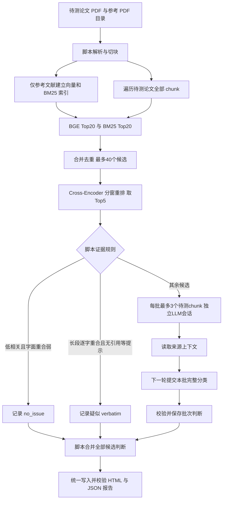

# Plagiarism Check Agent 设计

本文描述当前代码实现。项目定位是**在用户提供的参考文献范围内，定位论文中的疑似重复并提供证据**，不是全网论文查重服务，也不输出具有学术裁决含义的“抄袭概率”。

设计原则：确定的解析、检索、筛选、覆盖校验和报告写入交给脚本；需要结合原文和引用语境的分类交给 LLM。

## 1. 整体流程



Top5 是每个待测 chunk 的候选上限，不是强制交给 LLM 的数量。经脚本处理后可以剩下 0～5 个候选；全部候选都由脚本处理时，整次任务不调用 LLM，也不需要 API key。

## 2. 模块职责

| 模块 | 职责 |
| --- | --- |
| `cli.py` | `check`、轨迹 `inspect` 和训练数据 `export` 入口 |
| `pipeline/orchestrator.py` | 解析、建库、准备证据、调用批次运行器、返回任务结果 |
| `tools/document_tools.py` | PDF 文本、切块、参考快照、Chroma 向量检索、来源上下文 |
| `tools/haystack_retrieval.py` | Haystack BM25、候选去重及 Cross-Encoder 加载 |
| `tools/window_reranker.py` | 长文本分窗打分、验证返回候选身份和评分完整性 |
| `tools/review_gate.py` | 版本化的自动放行与逐字重复证据规则 |
| `tools/review_session.py` | 本任务候选、当前批次、已读证据、已提交判断及最终覆盖约束 |
| `agent/tool_router.py` | 工具参数和结果校验、阶段权限、证据完整性、结果大小限制 |
| `agent/runner.py` | 分批会话、工具调用循环、输入预算、错误与迭代保护、汇总 |
| `agent/skill_loader.py`、`skills/` | 加载本仓库的分析规则；原生工具 schema 单独传给模型 |
| `tools/report_tools.py` | 将明确的分类渲染为 HTML 和 JSON，不根据分数推断分类 |
| `trajectory/` | 真实调用轨迹、原始结果与模型可见结果、训练格式导出 |
| `evaluation/` | 审核样本、阈值回放和方案比较；不属于在线查重主流程 |

## 3. 文档与参考库隔离

待测论文和参考文献都需要解析、切块、向量编码，但**只有参考文献写入向量库**。待测 chunk 的向量用于查询，不写入该参考索引。

- 文档 ID 根据整个 PDF 的 SHA256 生成；同一文件的不同副本识别为同一文档。
- 明确传入参考文献白名单与待测论文排除名单，交集不为空时拒绝建库。
- 参考目录中待测论文的相同副本被跳过；重复参考 PDF 去重，支持 `.PDF` 后缀。
- 参考 PDF 无法解析或没有可检索文本时，任务失败；不会忽略它后宣称完成全库检测。
- 快照标识包含参考文件身份、chunk 文本哈希、切块参数、embedding 模型及权重版本。更换权重会创建新快照，避免错误复用旧向量。
- 每次运行创建独立输出目录和 `ReviewSession`。并行论文任务各自拥有文档、候选和报告状态。进程内串行化共享 Chroma 的初始化与建库，避免同目录并发创建产生竞争；这不是分布式写入方案。

相同 PDF 副本能够通过文件哈希排除。经过重新导出、内容编辑的待测论文副本不是同一文件，当前还没有完整的文档级近重复排除能力。

## 4. 检索与重排

### 4.1 双路候选召回

默认 embedding 为 `BAAI/bge-large-zh-v1.5`，固定权重版本。查询与参考文本使用相同模型并进行 L2 归一化，Chroma 采用 cosine 距离。代码保留的余弦分数范围是 `[-1, 1]`，不是重复概率。

BM25 使用 Haystack `InMemoryBM25Retriever`、BM25L 和 jieba 中文分词，进行 NFKC 与大小写归一化。它补充术语、专有名词等词项匹配。

两路各最多取20个，使用 Haystack `DocumentJoiner` 合并去重。原始 BM25 分数与余弦分数不做直接加权相加，也不拿同一阈值比较。不会因为 BGE 分数较低就删除 BM25 独立找到的候选。

这复用了 [Haystack 混合检索示例](https://haystack.deepset.ai/tutorials/33_hybrid_retrieval) 的候选召回与 Cross-Encoder 重排思路；主流程并不是整个 Haystack Pipeline 的直接复制。

### 4.2 Cross-Encoder

`BAAI/bge-reranker-base` 联合编码“待测文本、来源文本”，输出原始相关性 logit。`scale_score=False`，不做 Sigmoid，不解释为抄袭概率。BM25 与向量分数不作为这个打分模型的输入。

每对输入最多512 tokens。当前实现对双方长文本分别建立重叠窗口，比较全部窗口组合，再取最高分作为候选分数：

`score(query, source) = max(score(query_window_i, source_window_j))`

这是项目额外加入的策略。它覆盖后文，但增加本地计算量；局部高分不代表整段相同，窗口数量变化也可能影响分数分布。改变模型、切块或窗口策略后应重新校准阈值。

代码验证所有候选都被打分、候选 ID 和原文没有改变、分数有限，然后再取 Top5。重排失败时返回失败，不悄悄切换成未重排结果。

## 5. 当前筛选规则

自动规则基于当前候选对的完整原文。NFKC 规范化后保留英文词边界；中文 PDF 的多余空格会被修复。

| 路线 | 同时满足的条件 |
| --- | --- |
| 自动记录疑似逐字重复 | 最长连续相同文本至少120字符；待测文本13字符片段集合的覆盖率至少85%；未发现引用、引号或定义等提示 |
| 自动放行 | 完整窗口评分 `< 2`；最长连续相同文本 `< 40`字符；13字符片段集合覆盖率 `< 15%` |
| LLM 判断 | 其余候选 |

13字符片段覆盖率指：待测文本的不同13字符片段中，也在来源中出现的比例。它不是论文重复率。

逐字重复规则先于低分放行规则。分数等于2不会被低分规则放行。关闭 `AUTO_REVIEW_GATES` 后，全部检索候选交给 LLM。

阈值2及字面阈值均为开发规则，不是学术标准。引用提示检查仅覆盖当前待测 chunk，仍可能遗漏相邻段落中的标引。自动结论保留规则版本与证据特征，报告称其为疑似重复，最终需要人工复核。

## 6. LLM 分批判断与权限

脚本先完成全文检索与筛选，再给 LLM 分批提供待判断清单：

- 默认每批最多3个待测 chunk，并限制初始清单字符数。
- 每批重新建立消息历史，上一批的来源文本不累积进入下一批。
- 同一批内相同来源可以复用上下文；不同批次需要重新读取来源。
- 正常批次只暴露 `get_chunk_context`、`get_corpus_stats` 和 `submit_findings`。
- LLM 不能重新解析文档、修改检索参数、覆盖自动结论或指定报告路径。
- `submit_findings` 必须精确覆盖本批全部候选，包括 `no_issue`；重复、遗漏或跨批次 ID 会被拒绝。

低层工具 API 仍提供检索与报告方法，供脚本及契约测试使用；它们不是正常 LLM 批次的可用动作。

### 证据校验

来源必须来自本任务参考白名单。工具返回的来源 ID、文档身份与文本必须对应真实 chunk。成功返回的完整匹配原文才记为已读。

如果上下文过大，工具仅删除可选的邻居 chunk，保留匹配 chunk 的原文与 ID；主证据自身过大则明确报错。不会递归截断原文、ID 或候选列表后继续假装证据完整。

运行器还检查模型是否在**上一轮已经收到证据**：把读取工具和预先生成的判断塞进同一轮，不能绕过证据要求。校验能证明文本已提供，不能证明模型真的理解了文本；语义正确性仍需要评测。

## 7. 完成、失败与报告

每批通过校验后状态为 `reviewed`，只表示该批结构化判断已接受。全部批次完成后，脚本合并自动结论和 LLM 判断，再统一生成一份报告。

整篇论文只有在下列条件成立时才是 `completed`：

1. 所有待测 chunk 都已搜索，包含没有候选的 chunk。
2. 全部返回候选都有自动或 LLM 判断。
3. 输出路径绑定本任务，HTML、JSON 都存在。
4. JSON 中的快照与 findings 与当前任务的规范证据一致。

任何批次失败、模型提前结束、证据读取失败、输入预算超限或迭代耗尽，都不会生成声称整篇完成的最终报告。已完成批次的轨迹仍保留供排查；当前没有断点续跑功能。

`--dry-run` 只跳过最终报告写入。解析、建库、审计文件、轨迹以及必要的 LLM 调用仍会发生，因此不是免费运行开关。

HTML 进行文本转义；JSON 保留来源 ID、原文、两路分数、重排分数、判定来源、规则证据与覆盖统计。`total_findings` 是候选判断数量，不是抄袭段落数或重复率。

## 8. 预算与可观测性

| 配置 | 默认值 | 含义 |
| --- | --- | --- |
| `RETRIEVAL_POOL_SIZE` | 20 | 每一路召回候选上限 |
| `TOP_K_RESULTS` | 5 | 每个待测 chunk 重排后的候选上限 |
| `RERANKER_PASS_THRESHOLD` | 2 | 暂定的原始重排放行门槛 |
| `RERANKER_MAX_LENGTH` | 512 | 每对窗口的联合 token 上限 |
| `RERANKER_WINDOW_OVERLAP` | 32 | 窗口重叠预算，必要时为安全配对而缩小 |
| `REVIEW_BATCH_CHUNKS` | 3 | 每个独立 LLM 会话的待测 chunk 上限 |
| `REVIEW_BATCH_MAX_CHARS` | 12000 | 初始批次清单字符上限 |
| `MAX_INPUT_TOKENS` | 48000 | 每次 API 请求前的估计输入上限 |
| `MAX_TOOL_RESULT_TOKENS` | 6000 | 单次模型可见工具结果预算 |
| `MAX_ITERATIONS` | 50 | 每批模型会话迭代上限 |

输入预算使用 cl100k 估算；不可用时以 UTF-8 字节数保守估算，不等于所有模型提供商的精确 tokenizer。实际 token 消耗以 API usage 为准。循环保护识别重复调用与连续错误。

每次任务保存 `retrieval_audit.json`。各批轨迹记录真实 system、工具 schema、模型响应、工具原始结果及模型实际看到的 observation。最终脚本轨迹引用各批 session ID，汇总其调用次数和 usage，不伪造模型调用。

## 9. 轨迹与后训练数据

保留训练导出能力，因为它与 Agent 工具调用研究直接相关：

- `tool-supervision`：真实工具调用、输入及模型可见返回。
- `sft`：保留原生 `tool_calls` 协议；通过校验的批次可以以真实 `submit_findings` 调用作为最后训练目标。导出前先检查完整观察轨迹，再去掉最后的工具返回，不编造 assistant 确认语。
- 纯脚本报告没有模型输出，不导出成 SFT 样本。
- 结构与覆盖校验通过不代表分类是真值。未经额外评估的轨迹质量分为0；不能直接宣称是高质量训练数据。
- 偏好对仍要求显式验证评分及相同任务上下文，不能凭建议长度或输出数量构造“更好”的答案。

轨迹包含论文文本，默认留在本地生成目录，不作为公共仓库数据提交。

## 10. 已完成的评估与阈值依据

当前没有完成独立的公开 Agent benchmark。已经完成的开发验证包括：

- 40组人工审核文本对，其中8个重复正例均为构造对照；7个原待定样本由助手按授权补充判断，并与原始人工记录分别保存。
- 本地真实 BGE 编码28个去重查询，复用1640个参考向量；评分与冻结记录一致。
- 8个构造正例的来源，在 BGE Top20 中命中7个，在双路候选池中命中8个；这不是最终 Top5 或完整系统召回率。
- 4个已确认正常引用的对照余弦为0.905～0.949，因此没有采用“余弦超过0.9直接判重复”。
- 16个真实段落的80对候选，重排阈值0保留69对供 LLM，阈值2保留44对，阈值4保留18对。0.6向量预筛未进一步减少该批合并候选。

这些数字来自冻结候选与完整窗口分数回放，没有调用收费 LLM，不能当成当前分批流程的实际 token、费用、延迟或端到端准确率。评分和回放参数保存在实验输出中，历史阈值0作为对照保留。

约200组对比文本是下一阶段计划，尚未完成。正式校准需按来源论文分组，分离校准集和独立测试集，覆盖复制、改写、局部重复、引用、同主题负例和输入异常；优先控制重复证据被误放的比例，再比较 LLM 工作量。

`evaluation/review_pack.py` 负责证据包与审核；`calibrate_review.py` 扫描阈值；`replay_gates.py` 使用完整窗口策略回放；`compare_screening.py` 对比筛选方案。它们用途不同，保留为研究工具。

### 10.1 为什么当前采用阈值2

这是基于小规模开发验证作出的工程选择，尚不是独立测试确认的最优阈值：

1. 固定 `bge-reranker-base` 权重及完整窗口取最大值的评分策略，比较多个原始分数门槛。
2. 在40组已审核文本对中，阈值5会自动放过一个已知构造改写正例 R33；阈值0、2、4没有自动放过本批已知正例。这只验证了过滤阶段，不能推断后续 LLM 一定判断正确。
3. 选择2而非更激进的4，为改写重复保留更大的分数余量。本批正例少且来自构造对照，不宜只追求开发集上的最大过滤量。
4. 另用16个真实段落检查工作量：阈值2将80对候选减至44对需要 LLM；与当前实际 API token 或费用降幅无直接等价关系。
5. 放行还要求字面重合较弱，不能只用 `reranker_score < 2` 单独判定；分数等于2仍保留判断。

“约200组”是后续数据建设的起步计划，不是已经完成的审核数量，也不是确定阈值必须满足的固定数量。正式方案是：构建有可靠标签的文本对，按论文来源分离校准集与独立测试集；在校准集上扫描阈值，优先控制重复证据的误放，再比较工作量；锁定阈值后在独立测试集验证。

可用于介绍当前进度的表述：

> 我准备了40组开发用对比文本，包含真实检索样本和构造对照，覆盖复制、改写、正常引用和同主题不同内容。固定重排模型及分窗策略后，我比较了多个阈值；阈值5出现已知改写正例被自动放过，2和4在本批没有误放已知正例，因此先采用更保守的2。在另外16个真实段落回放中，80对候选减少到44对需要LLM。这个结果反映候选工作量变化，后续仍需独立测试验证阈值。

不能将上述进度描述为“已在200组独立真实样本上验证阈值2最优”，也不能将构造样本、助手补充判断与独立人工测试混为一种证据。

### 10.2 真实端到端验证方案（计划，尚未执行）

118项自动化测试主要使用受控模型响应验证工程契约。真实端到端验证需要从实际 PDF 入口调用 `check`，经过真实解析、embedding、BM25、reranker、筛选、真实 LLM API 和最终报告，才能评价当前系统的实际行为。

建议先分两步推进：

| 阶段 | 输入 | 回答的问题 |
| --- | --- | --- |
| 第一轮：5个受控 PDF 任务 | 有明确来源和预期结果的复制、改写、正常引用、独立内容、长文多批次样例 | 整个链路是否真正运行，LLM是否读取证据、正确分类并形成报告 |
| 第二轮：少量真实论文任务 | 新论文及对应参考库，审核真实可疑区域，并保留未判定区域 | 真实写作与 PDF 噪声下的检出、误报和人工使用体验 |

受控 PDF 可以使用明确标记的合成文本，但应称为“受控 PDF 全链路验证”，不能冒充自然论文 benchmark。第二轮优先使用未参与阈值选择的论文；未标注区域不能自动当作无问题负例。

第一轮5个任务的预期覆盖：

- **独立内容**：同领域但论证、数据或方法实质不同，检查误报。
- **明确复制**：已知来源片段未经恰当标引出现，检查自动规则与最终证据。
- **语义改写**：已知重复关系需要上下文判断，检查候选能否进入真实 LLM，并检查分类。
- **规范引用**：文字高度相似但引用恰当，按项目已确认口径应判无问题。
- **长文与多批次**：多个待判断区域，包含后文的已知重复，检查全部批次及最终合并。

真实 LLM 验证中必须实际出现灰区候选和 API 调用；全部内容被脚本处理的任务只能验证脚本路径。某个已知重复被阈值提前放行属于测试发现的问题，不能把“没调用LLM”直接作为成功节省成本。

#### 标签与错误定位

每个已知重复记录待测 PDF 页码/文本范围、正确来源及来源范围、重复关系、引用情况和最终项目标签。尽量以文本范围和来源对齐，而非只绑定易受切块影响的 chunk ID；重叠 chunk 对同一证据应去重统计。

若最终未检出，逐层检查：原文是否成功提取 → 正确来源是否进入双路候选池 → 是否进入Top5 → 是否被阈值误放 → LLM是否误判。不能把检索漏检全部归因于 LLM，也不能只对成功召回的样本计算整体召回。

#### 准确性、成本与稳定性分别记录

| 维度 | 应记录的结果 | 当前记录的边界 |
| --- | --- | --- |
| 判断效果 | 已知重复检出数/总数、错误判重复的审核样本数、正常引用误报、具体错误案例 | `completed`仅说明流程与报告校验通过，不说明语义判断正确 |
| API用量 | 输入/输出token、成功响应数、请求失败、重试；按提供商账单核对费用 | 当前usage记录输入/输出token；`llm_calls`统计已记录的模型响应，不等于包含SDK重试的全部HTTP请求次数 |
| 耗时 | 从PDF入口到报告完成的总耗时，及解析、建库、检索重排、LLM阶段耗时 | 当前轨迹`duration_ms`主要覆盖会话与报告阶段，不能直接当整条链路总耗时 |
| 运行稳定性 | 每次运行完成或失败、工具错误与修正、证据覆盖、报告是否完整 | 工程故障注入与真实模型重复运行分开统计 |
| 判断一致性 | 同一任务重复运行时的分类、来源及建议依据是否一致 | 不要求生成文本逐字相同，也不把三次一致解释为总体稳定性证明 |

成本暂先比较真实 token 用量；人民币或美元费用应按运行当天提供商价格、缓存等计费项计算，不写未经核对的固定金额。还需记录提供商返回的模型标识、代码提交、提示词、参考快照、阈值、预算和推理参数；未显式设置的参数也应注明。当前轨迹的模型字段记录请求模型名，提供商返回标识尚需补采；若提供商不公开权重版本，不宣称已固定远程模型权重。

为控制第一轮成本，先跑5个任务各一次，修复流程问题后，仅选择2～3个有代表性的灰区任务各追加2次复跑，使这些任务各有3次记录。小样本报告原始计数及失败案例，不据此宣称大规模准确率或给出缺乏样本支持的尾部延迟指标。索引首次构建和复用缓存的运行应分别标记。

在真正执行前，需明确测试模型、可用API配置、样本和费用上限。本文仅记录验证方案，没有产生真实API准确率、成本或稳定性成绩。

## 11. 本轮清理与尚存限制

已删除与主任务无关的作者画像、研究领域猜测、自动推荐论文、跨论文热点记忆及历史数据迁移。跨任务未验证记忆不再进入系统提示，查重完成后不再自动访问推荐服务。

已删除旧 `eval.py` 和其12组演示数据：旧流程没有运行当前双路重排 Agent，还将调用失败默认成正常或按余弦分类，容易让演示分数被误当成 benchmark。报告模块中类似的余弦自动分类后备逻辑也已移除。旧本地生成数据不会自动删除。

仍需后续验证或改进的地方：

- PDF 主要依赖可提取文字，没有 OCR；非空但乱码、公式、双栏顺序仍可能影响质量。
- 切块按 PDF 文本行聚合并重叠，512是目标字符预算；异常长行与重叠可能超过该目标。暂未改动切块算法，避免不经重评就改变现有阈值依据。
- Embedding 最多处理512 tokens，初始向量召回仍可能截断长输入；reranker 分窗不能补救未进入候选池的全部证据。
- 默认 embedding 偏中文，英文与跨语言检出能力没有充分验证。
- 引用范围识别、标准表达保护、自动逐字判定及阈值2尚未通过大规模独立验证。
- 候选保存在内存，本地 BM25 面向当前规模；大库、超长论文与并发场景还没有压力测试。
- 依赖固定 Haystack 2.31.1；升级主要版本需要单独迁移与回归。

`dense` 和不带重排的 `hybrid` 模式只用于对照与消融实验。正常运行保持 `hybrid_rerank`，不会把这些模式并行执行后重复调用 LLM。

## 12. 运行与验证

```bash
python cli.py check thesis.pdf --refs ./references --output-dir ./output
python cli.py inspect ./trajectories/trace_<session_id>.jsonl
python cli.py export --input ./trajectories --format sft tool-supervision

HAYSTACK_TELEMETRY_ENABLED=False ANONYMIZED_TELEMETRY=False \
  PYTEST_DISABLE_PLUGIN_AUTOLOAD=1 python -m pytest -q -p no:cacheprovider
```

依赖见 `requirements.txt` 与 `requirements-dev.txt`，环境配置示例见 `retrieval.example.env`。模型权重、论文、向量索引、审核文件、轨迹与报告均为本地生成资源。自动化测试主要替换远程模型和神经计算，验证真实工具契约与任务状态；它们不能代替真实模型的检出效果评估。
